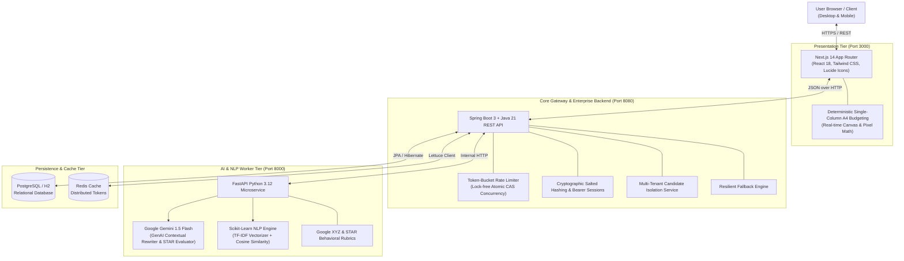
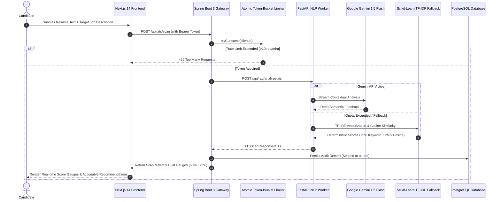

# 🏛️ CareerFlow System Architecture & Design

This document describes the architectural principles, data flows, concurrency controls, and security boundaries implemented in **CareerFlow**.

---

## 🏗️ 1. High-Level Decoupled Microservices Architecture

CareerFlow is engineered on a distributed, microservices-oriented topology designed for high availability, low latency, and clear separation of concerns.



---

## ⚡ 2. End-to-End Candidate Intelligence Flow

The sequence diagram below traces an ATS resume scan and bullet point optimization request across all tiers:



---

## 🧮 3. Algorithmic Deep Dives

### A. Two-Tier ATS Composite Scoring Algorithm
The ATS scanner evaluates resumes across technical job relevance and Taleo/Workday structural health:

1. **TF-IDF Semantic Vectorization:**
   $$\text{TF-IDF}(t, d, D) = \text{TF}(t, d) \times \log\left(\frac{|D|}{1 + |\{d \in D : t \in d\}|}\right)$$
2. **Cosine Similarity:**
   $$\text{Cosine Similarity} = \frac{\mathbf{A} \cdot \mathbf{B}}{\|\mathbf{A}\| \|\mathbf{B}\|} = \frac{\sum_{i=1}^{n} A_i B_i}{\sqrt{\sum_{i=1}^{n} A_i^2} \sqrt{\sum_{i=1}^{n} B_i^2}}$$
3. **Blended Composite Score:**
   $$\text{raw\_job\_match} = (0.75 \times \text{keyword\_match\_pct}) + (0.25 \times \text{semantic\_sim})$$
   $$\text{overall\_ats\_score} = (0.70 \times \text{job\_match\_score}) + (0.30 \times \text{format\_health\_score})$$

### B. Lock-Free Atomic CAS Rate Limiter
To eliminate lock contention and thread starvation under high concurrent traffic, the rate limiter utilizes `AtomicInteger` and `AtomicLong` with Compare-And-Swap (CAS) loops:

```java
// Thread-safe lock-free consumption in RateLimiterService.java
int currentTokens = bucket.tokens.get();
while (currentTokens > 0) {
    if (bucket.tokens.compareAndSet(currentTokens, currentTokens - 1)) {
        return true; // Successfully acquired token without lock bottlenecks
    }
    currentTokens = bucket.tokens.get();
}
return false; // Rate limit exceeded (10 requests/min window)
```

---

## 🔒 4. Enterprise Security & Multi-Tenant Data Isolation

1. **Cryptographic Salted Hashing:**
   Candidate passwords are never stored in plaintext. Each account generates a cryptographically secure 16-byte random salt using `SecureRandom`, concatenated and hashed via SHA-256 / Bcrypt.
2. **IDOR & BOLA Prevention:**
   All candidate data queries (saved CV drafts, historic scan records) enforce strict tenant boundaries:
   ```sql
   SELECT c FROM UserCVDraft c WHERE c.user.id = :authenticatedUserId
   ```
   Cross-user data leakage is mathematically impossible at the database query layer.
3. **Information Disclosure Prevention:**
   Actuator and SQL properties in `application.yml` suppress internal schema and infrastructure metadata (`show-details: never`, `show-sql: false`).
