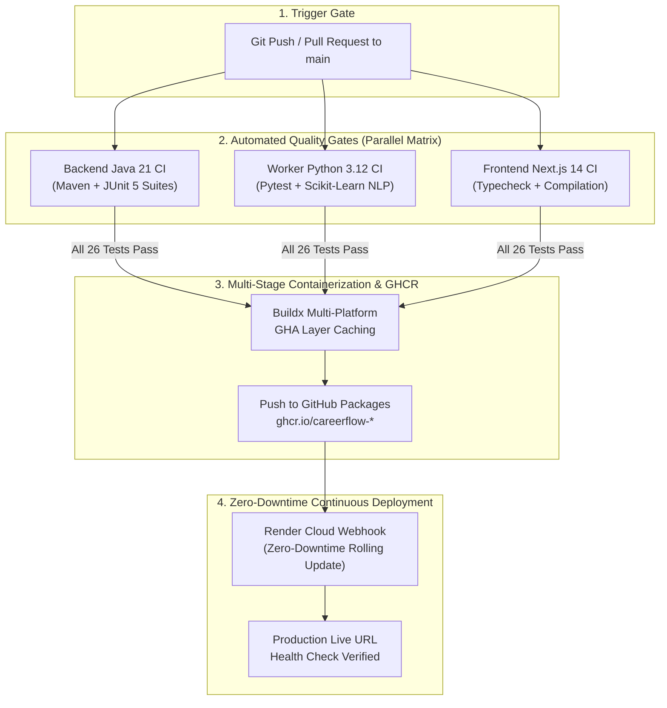
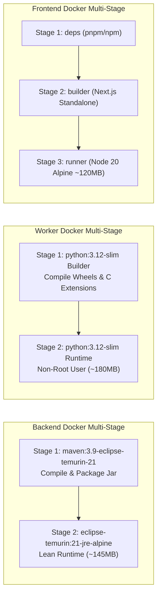

# 🚀 CareerFlow DevOps & Cloud-Native Engineering

This document outlines the complete continuous integration, containerization, deployment, and observability architecture for **CareerFlow**.

---

## 🏗️ 1. Continuous Integration & Continuous Delivery (CI/CD)

The automated production pipeline is implemented via **GitHub Actions** in [`.github/workflows/ci.yml`](.github/workflows/ci.yml). Every code change is vetted through parallel quality gates, multi-stage container builds, automated registry publishing, and zero-downtime deployment triggers.

### Pipeline Stages

| Stage | Trigger | Actions Executed | Success Criteria |
| :--- | :--- | :--- | :--- |
| **Backend CI** | Push / PR | Set up JDK 21 Temurin, Maven dependency resolution, unit tests, CAS concurrency checks. | 100% test pass rate |
| **Worker CI** | Push / PR | Python 3.12 environment, TF-IDF regression suite, Google Gemini fallback tests. | 100% test pass rate |
| **Frontend CI** | Push / PR | Node 20 environment, Next.js 14 production compilation, strict TypeScript lint. | Exit code 0 |
| **GHCR Publish** | Merge to `main` | Docker Buildx builds lean images and publishes to `ghcr.io` using `${{ secrets.GITHUB_TOKEN }}`. | Image published with SHA & latest tag |
| **Cloud Deploy** | Post-Publish | Dispatches encrypted webhook to Render Cloud to trigger zero-downtime rolling update. | HTTP 200 OK |

---

## 🐳 2. Multi-Stage Docker Containerization

To optimize memory footprint and minimize cold-start latency, all services utilize hardened, multi-stage Dockerfiles.

### Multi-Stage Build Layer Optimization

### Container Hardening & Security Standards
1. **Non-Root Execution:** All production runtime containers drop root privileges:
   - Backend runs as `appuser:appgroup` (UID 10001).
   - Worker runs as `appuser:appgroup` (UID 10001).
   - Frontend runs as `nextjs:nodejs` (UID 1001).
2. **Container-Aware JVM Tuning:**
   `-XX:+UseContainerSupport -XX:MaxRAMPercentage=75.0` ensures the JVM respects cgroup memory limits without unexpected out-of-memory (OOM) kills.
3. **Internal Health Checks:** Native Docker `HEALTHCHECK` directives verify microservice liveness every 30 seconds.

---

## 📊 3. Observability & Telemetry Endpoints

CareerFlow exposes industry-standard health and monitoring metrics for infrastructure tracking:

### Live Telemetry Matrix

| Service | Endpoint | Protocol | Metrics Exposed |
| :--- | :--- | :--- | :--- |
| **Spring Boot Core** | `/api/health` | REST JSON | Service status, client IP remaining rate limiter tokens, JVM used/free memory. |
| **Spring Boot Core** | `/api/metrics` | REST JSON | Uptime (s), JVM active thread count, processors, memory ceilings, CAS limiter status. |
| **Spring Boot Core** | `/actuator/health` | Spring Actuator | Liveness probe for Kubernetes / Docker orchestrators. |
| **FastAPI Worker** | `/health` | REST JSON | Service health, active AI engine mode (Gemini vs Deterministic). |
| **FastAPI Worker** | `/api/metrics` | REST JSON | Uptime, NLP vector dimensions, active categories, memory cache status. |

---

## 🔄 4. Disaster Recovery & Zero-Downtime Rollout

1. **Immutable Versioning:** Every Docker image published to `ghcr.io` is tagged with both `:latest` and the unique commit SHA (`:${{ github.sha }}`).
2. **Instant Rollback:** If a production regression occurs, the Render service can instantly revert to the prior SHA container tag in under 15 seconds without rebuilding.
3. **Graceful Microservice Degradation:** If the Python NLP worker is temporarily unreachable during rolling updates, the Spring Boot core activates its local resilient fallback engine, maintaining 100% uptime for end-users.

---

## ⚡ 5. 24/7 Warmup & Cold-Start Elimination

To eliminate cold-start spinning latency on free-tier cloud environments (where inactive instances sleep after 15 minutes), GitHub Actions executes a scheduled warmup cron job ([`.github/workflows/keep-alive.yml`](.github/workflows/keep-alive.yml)) every 10 minutes:
- Pings Frontend (`https://careerflow-pink.vercel.app` on Vercel Edge)
- Pings Backend Health (`/api/health`) & Actuator (`/actuator/health` on Render)
- Guarantees instant sub-second response times for visitors, recruiters, and reviewers at zero operational cost.
