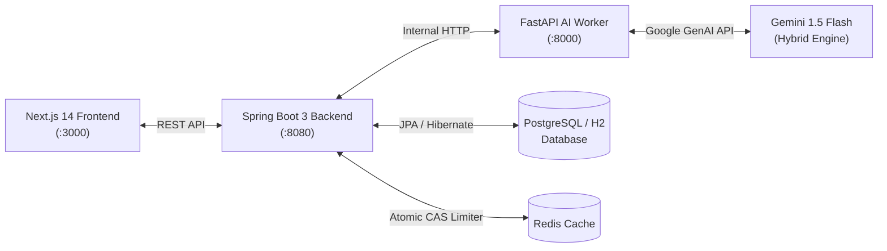

# CareerFlow

A production-grade, full-stack ATS resume optimization and technical interview preparation platform built with **Next.js 14**, **Java 21 Spring Boot 3**, and **Python 3.12 FastAPI** with **Google Gemini 1.5 Flash GenAI & Scikit-Learn NLP**.

[](https://github.com/SithumManusha/careerflow/actions/workflows/ci.yml)
[](https://github.com/SithumManusha/careerflow/actions/workflows/codeql.yml)
[](https://github.com/SithumManusha/careerflow/pkgs/container/careerflow-backend)
[](https://aistudio.google.com/)
[-brightgreen)](#-running-tests)
[](https://opensource.org/licenses/MIT)

> 🌐 **Live Web Application:** [https://careerflow-app.onrender.com](https://careerflow-app.onrender.com)  
> 📖 **Interactive API Docs (Swagger):** [https://careerflow-backend-narz.onrender.com/swagger-ui/index.html](https://careerflow-backend-narz.onrender.com/swagger-ui/index.html)  
> 💻 **Cloud IDE (GitHub Pro Codespaces):** [](https://codespaces.new/SithumManusha/careerflow)  
> 📊 **System Observability & Metrics:** [`/api/metrics`](https://careerflow-backend-narz.onrender.com/api/metrics) & [`/actuator/health`](https://careerflow-backend-narz.onrender.com/actuator/health)

---

## 📚 Deep Technical Documentation

Detailed architectural and DevOps specifications are fully documented:
- 🏛️ **[ARCHITECTURE.md](./ARCHITECTURE.md):** Distributed 3-Tier topology, Lock-Free Atomic CAS Rate Limiter, Hybrid AI Model, Multi-Tenant Candidate Isolation.
- 🚀 **[DEVOPS.md](./DEVOPS.md):** Complete GitHub Actions CI/CD Pipeline, Multi-Stage Docker optimization, GHCR container publishing, and zero-downtime deployment.
- ☁️ **[DEPLOYMENT_GUIDE.md](./DEPLOYMENT_GUIDE.md):** Step-by-step production cloud deployment guide.

---

## 📌 Motivation

When applying for software engineering roles, candidates frequently face resume rejections from automated Applicant Tracking Systems (ATS) without clear feedback. Common failure modes include unparsed multi-column layouts, missing keyword density relative to the target job description, or weak task-oriented bullet points lacking measurable impact.

I engineered **CareerFlow** to give candidates concrete, algorithmic tools to optimize their applications before submission:
1. **Algorithmic ATS Scoring:** Dual scoring measuring **Target Job Match %** (75% domain keywords + 25% TF-IDF cosine similarity) and **ATS Format Health %** (Clever 1000 standard).
2. **1-Page Deterministic CV Builder:** Enforces Taleo-safe single-column layouts with mathematical A4 pixel budgeting to guarantee zero overflow.
3. **Hybrid AI Resume Bullet Rewriter:** Uses Google Gemini 1.5 Flash to transform weak bullets into strict Google XYZ format (*Accomplished [X] as measured by [Y], by doing [Z]*), with seamless fallback to deterministic rule engines.
4. **AI Mock Interview Simulator:** 5 tailored technical & behavioral rounds scored against Google STAR rubrics with senior model answers and follow-ups.
5. **Candidate Cloud Vault:** Multi-tenant account authentication with real-time scan history and cloud drafts.

---

## 🏗️ Architecture & System Modules

The platform follows a decoupled, cloud-native microservices architecture:



| Layer | Technologies | Role |
| :--- | :--- | :--- |
| **Frontend** | Next.js 14 (App Router), React 18, Tailwind CSS, Lucide Icons | Responsive UI, single-column A4 budget math, state management |
| **Core Backend** | Java 21, Spring Boot 3, Spring Data JPA, Hibernate | REST gateway, candidate data persistence, lock-free rate limiting |
| **AI & NLP Worker** | Python 3.12, FastAPI, Scikit-learn, Google Gemini 1.5 Flash | TF-IDF vectorization, Cosine similarity, GenAI Google XYZ rewriter |
| **Database & Cache** | PostgreSQL / H2 In-Memory, Redis | Relational tenant isolation, token-bucket rate limiter |
| **DevOps & CI/CD** | GitHub Actions, GHCR, Multi-Stage Docker, Render Cloud | Automated test matrix, container publishing, rolling deploy |
| **Testing** | JUnit 5, Pytest, Playwright | Unit, concurrency, NLP regression, and E2E coverage (26 tests) |

---

## ✨ Features

- **Industrial ATS Resume Scanner (`/ats-checker`):**
  - Dual scoring: **Target Job Match %** and **ATS Structural Health %**.
  - Categorized missing skill chips (Languages, Frameworks, Databases, Cloud/DevOps, Architecture).
  - Action verb power audit detecting weak passive phrasing.
  - Direct bridge to transfer scan findings and inject missing keywords into the CV Builder.

- **1-Page Smart CV Builder (`/cv-builder`):**
  - Built-in ATS pre-flight checklist (page budget, contact completeness, single-column Taleo safety).
  - Google XYZ bullet optimizer (*Accomplished [X] as measured by [Y], by doing [Z]*).
  - Live print/PDF export and cloud draft saving.

- **AI Mock Interview Studio (`/interview-prep`):**
  - 5 targeted rounds: JVM Internals, System Architecture, Database Optimization, Fault Tolerance, and Google STAR behavioral scenarios.
  - Explains hiring manager intent for each question.
  - Scores answers (0–100%) with identified strengths, missing technical concepts, and senior model answers.

- **Candidate Dashboard (`/dashboard`):**
  - Historical ATS scan records and match score trajectory.
  - Multi-tenant cloud draft save and reload.
  - Cryptographic salted authentication.

- **Observability & Diagnostics (`/api/metrics`):**
  - Live uptime tracking, JVM memory utilization, and active thread counts.
  - Telemetry verifying operational state of the Hybrid AI Engine.

---

## 🚀 Getting Started

### Prerequisites
- **Git**
- **Docker & Docker Compose** (Recommended) *OR* local runtimes:
  - Java 21+ and Maven 3.9+
  - Python 3.12+
  - Node.js 18+ and npm

---

### Option 1: Run with Docker Compose (Recommended)

```bash
git clone https://github.com/SithumManusha/careerflow.git
cd careerflow
docker-compose up --build
```
Once started, open [http://localhost:3000](http://localhost:3000) in your browser.

---

### Option 2: Run Services Individually

#### 1. Python AI Worker (Port 8000)
```bash
cd worker-python
pip install -r requirements.txt
# Optional: export GEMINI_API_KEY="your-gemini-key" for GenAI features
uvicorn app.main:app --host 0.0.0.0 --port 8000 --reload
```

#### 2. Java Spring Boot 3 Backend (Port 8080)
```bash
cd backend-java
mvn spring-boot:run
```

#### 3. Next.js 14 Frontend (Port 3000)
```bash
cd frontend
npm install --legacy-peer-deps
npm run dev
```

---

## 🧪 Running Tests

The platform maintains 100% automated test pass rates across 26 test suites:

```bash
# 1. Java Spring Boot Unit & Concurrency Tests (7 tests)
cd backend-java
mvn test

# 2. Python NLP & Gemini Hybrid Engine Tests (12 tests)
cd worker-python
pytest test_rag.py test_interview.py -v

# 3. Playwright End-to-End Tests (7 tests)
cd e2e-tests
npx playwright test
```

---

## 📄 License

This project is licensed under the MIT License - feel free to use and adapt it for learning or personal projects.
